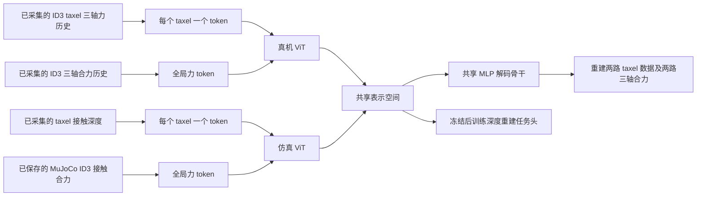

# 架构与 TactSpace 对应关系

## 论文事实与本项目选择

依据 [arXiv:2606.18959 的 III-B、III-C、IV-A](https://arxiv.org/html/2606.18959)：每种模态使用独立 ViT，共享 MLP 解码骨干加模态专用输出头；任意模态的表示都重建全部模态；表示使用 InfoNCE 对齐。编码器完成联合训练后冻结，下游 MLP 仅用仿真数据训练，再以真机表示测试。

论文的真实传感器是 12×12 电容阵列，包含 10 帧历史；另外使用刚体仿真的穿透深度和 FEM 的应力场。本项目改为单片 ID3，并采用用户指定的两路输入，不包含 FEM 应力场，因此不宣称完整重现论文的多物理场增益。

ViT 层数、维度、温度、学习率与权重均为本实现的可调工程默认值，不声称是论文未公布的精确超参数。

## 两条输入路径



默认真实历史 `Hr=10`，仿真历史 `Hs=1`。真实 taxel 投影输入为 `Hr×3`，仿真 taxel 输入为 `Hs×1`；两个分支的全局力投影输入分别为 `Hr×3`、`Hs×3`。同一路的力与 taxel 必须使用完全相同的时间窗口，不能取未来力读数。

每个 taxel 的位置与法向经过位置编码，坐标按固定 1 cm 缩放；不把 120 个曲面 taxel 人为声称为论文的 12×12 图像。`CLS` 输出经 L2 归一化，统一用于对齐、解码和下游头。

### 默认配置对应的张量与模块

以下对应 `configs/id3_pretrain.json`，`B` 是 batch 大小，`N=120`。短训练配置使用较小的宽度和层数，只用于流程测试。

| 模块 | 输入／输出 | 当前实现 |
|---|---|---|
| 真机局部投影 | `[B,10,120,3] → [B,120,96]` | 每个 taxel 的 30 个历史分量经 Linear 投影 |
| 真机力 token | `[B,10,3] → [B,1,96]` | 独立 Linear，加 token 类型嵌入 |
| 仿真局部投影 | `[B,1,120,1] → [B,120,96]` | 每个 taxel 的深度投影 |
| 仿真力 token | `[B,1,3] → [B,1,96]` | 独立 Linear，加 token 类型嵌入 |
| 物理位置编码 | `[B,120,6] → [B,120,96]` | xyz 与法向经过两层 MLP，加入 taxel token |
| 两个独立 ViT | 每路 122 个 token → `[B,64]` | 120 taxel＋1 CLS＋1 合力；3 层、4 头、宽度 96，FFN 宽度 384 |
| 表示输出 | `[B,96] → [B,64]` | CLS、LayerNorm、Linear、L2 归一化 |
| 共享解码骨干 | `[B,64] → [B,192]` | 两层 MLP，GELU |
| 真机重建头 | `[B,10,120,3]` 和 `[B,10,3]` | 重建 taxel 三轴历史和模块合力历史 |
| 仿真重建头 | `[B,1,120,1]` 和 `[B,1,3]` | 重建深度和仿真合力 |
| 下游深度头 | `[B,64] → [B,120]` | 64→128→120 的 MLP，当前帧逐 taxel 深度 |

两个编码器参数独立；同一个解码骨干与同一组输出头分别接收 `zr` 和 `zs`，不是两套互不共享的自编码器。第一阶段联合训练后才冻结编码器，不是先分别训练再冻结后做对齐。

## 损失

记 `r=(真机taxel力,真机合力)`，`s=(仿真深度,仿真合力)`，编码器输出 `zr,zs`。

总损失为 `λalign × InfoNCE(zr,zs) + λrecon × Lrecon`。

`Lrecon` 是 `r→r、r→s、s→r、s→s` 四条路径的平均值。每条路径包含两部分：

```
L(source → target)
  = [MSE(target taxels) + λforce × MSE(target force)] / (1 + λforce)
```

所有 MSE 都在训练集 RMS 归一化后计算；真机 taxel 三轴、仿真深度、真机合力三轴、仿真合力三轴分别拟合尺度。有效 taxel 掩码只作用于局部图，不遮蔽整个传感器的合力。日志单独记录四条路径的 taxel 和合力误差，避免整体损失掩盖某个输出失败。

`use_module_force=false` 是显式消融：同时移除两路力 token 和力重建头；默认 `true`。`alignment` 支持 `infonce`、`mse`、`none`；`cross_reconstruction=false` 可仅保留自重建。可对比历史长度 1 与 10、增加仿真历史等。

新增仿真合力有助于表达接触载荷与切向分量，但全局三轴合力仍不能唯一确定逐 taxel 的切向力分布。交叉重建的不确定性和真实标定误差仍然存在。

## 下游协议

冻结两个编码器的所有参数并固定为评估模式，只训练 MLP。训练输入为 `(仿真深度,仿真合力)`，默认输出为当前帧逐 taxel 深度；部署输入为 `(真机taxel三轴力,真机合力)`。

仿真域的深度任务本质上是表示的自编码探测，不能仅凭仿真误差判断迁移成功。应报告真机测试的全图 MAE、接触区域 MAE、轨迹平均 MAE，并与全零深度、无对齐、无交叉重建、无合力等基线比较。真实测试深度标签需要上游验证过的几何配对。

模型还保留分类和通用回归头接口。因为两域输入已经包含合力，不能将预测同一合力当作独立迁移能力证据；若做该实验，应去除合力输入或采用独立目标。

## 仓库分层与实现状态

| 层级 | 文件／位置 | 职责与状态 |
|---|---|---|
| 外部采集 | 真机 SDK、MuJoCo replay | 不在本仓库执行；按 [采集清单](collection_plan.md) 交付记录 |
| 离线适配 | `src/tacdex/adapters.py` | 已实现已解码数组的 ID3 提取、几何表读取和时间匹配；专有 SDK 原始消息尚未核对 |
| 数据输入 | `src/tacdex/data.py` | 已实现 v2 校验、分区检查、因果历史、独立通道 RMS 归一化 |
| 表示网络 | `src/tacdex/models.py` | 已实现两个几何位置编码 ViT、共享解码器与四类输出 |
| 优化目标 | `src/tacdex/losses.py` | 已实现对称 InfoNCE、自／交叉重建、力误差分项、消融开关 |
| 训练评估 | `src/tacdex/training.py` | 已实现两阶段训练、验证集选模型、checkpoint 和深度测试指标 |
| 使用入口 | `src/tacdex/cli.py`、`configs/` | 已实现校验、预训练、任务头训练与评估命令 |
| 流程验证 | `tests/`、`src/tacdex/synthetic.py` | 已完成离线核心测试和 GPU 合成数据闭环；不是实测性能验证 |
| 可选实验工具 | `src/tacdex/simulation.py` | 早期射线辅助代码，不参与离线训练调用链；没有新增 replay 采集流程 |

目前未实现或未完成：真实 SDK 端到端转换器、真实配对数据训练、真实 ID/OOD 迁移指标、论文 FEM 模态，以及真实硬件坐标标定。具体可复现的测试结果和已知环境限制见 [validation.md](validation.md)。

## 与原论文的迁移范围对照

| 项目 | 论文方法／设置 | 当前 ID3 实现 |
|---|---|---|
| 真机输入 | 12×12 电容阵列及 10 帧历史 | 逐 taxel 三轴力＋整片 ID3 三轴合力，默认 10 帧 |
| 仿真模态 | 刚体穿透深度，另有 FEM 应力场 | 单片深度＋MuJoCo 求解器直接合力，不含 FEM |
| 编码器 | 每个模态独立 ViT | 两个独立 ViT，每个 taxel 为一个 token，加入曲面几何信息 |
| 重建 | 共享 MLP 骨干、模态专用头，任一路重建全部模态 | 保留这一原则，同时重建两路合力 |
| 对齐 | 成对物理刺激的 InfoNCE | 对称 InfoNCE；重复的同一刺激支持多正样本 |
| 下游 | 冻结编码器，仿真训练、真机零样本评估 | 首先实现深度图重建；分类／回归保留接口 |
| 实验结论 | 论文自身的硬件、数据和结果 | 尚无真实 ID3 迁移结论；不能直接引用为本项目性能 |
